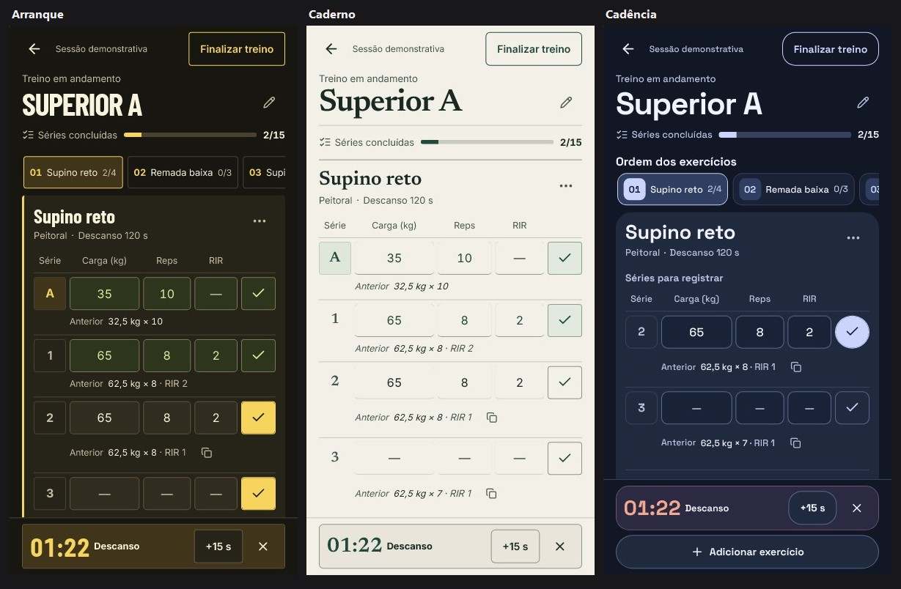

# Revisão visual do Workout Tracker

As três propostas podem ser testadas na [galeria local](http://127.0.0.1:4180/design.html). Para reabrir o ambiente, execute `npm ci` e `npm run design`. A aplicação 0.1.0 segue acessível pelo fluxo normal de execução descrito no [README](../../README.md).

A demonstração oferece três rotinas, sessões das últimas semanas e um treino em andamento com carga decimal, aquecimento, RIR e descanso. Cada página usa um repositório em memória. Recarregar a página repõe os dados de exemplo. O build das propostas fica separado em `dist-design` e tem a instalação da PWA desativada.

### Arranque

Grafite quente, amarelo e Barlow Condensed. A abertura destaca a rotina e a semana de treino. O editor mostra a sessão inteira, com atalhos que levam ao exercício e confirmação de alto contraste para a próxima série.

[Explorar com dados](http://127.0.0.1:4180/design.html?direction=arranque) · [Testar treino ativo](http://127.0.0.1:4180/design.html?direction=arranque&state=active#/treino) · [Explorar vazio](http://127.0.0.1:4180/design.html?direction=arranque&state=empty)

| Dispositivo | Início | Rotinas | Treino ativo | Histórico | Progresso |
| --- | --- | --- | --- | --- | --- |
| Mobile | [Início](capturas/arranque/mobile-inicio.jpg) | [Rotinas](capturas/arranque/mobile-rotinas.jpg) | [Treino ativo](capturas/arranque/mobile-treino.jpg) | [Histórico](capturas/arranque/mobile-historico.jpg) | [Progresso](capturas/arranque/mobile-progresso.jpg) · [Gráfico](capturas/arranque/mobile-progresso-detalhe.jpg) |
| Desktop | [Início](capturas/arranque/desktop-inicio.jpg) | [Rotinas](capturas/arranque/desktop-rotinas.jpg) | [Treino ativo](capturas/arranque/desktop-treino.jpg) | [Histórico](capturas/arranque/desktop-historico.jpg) | [Progresso](capturas/arranque/desktop-progresso.jpg) |

Estados vazios no celular · [Início](capturas/arranque/mobile-inicio-vazio.jpg) · [Rotinas](capturas/arranque/mobile-rotinas-vazio.jpg) · [Treino](capturas/arranque/mobile-treino-vazio.jpg) · [Histórico](capturas/arranque/mobile-historico-vazio.jpg) · [Progresso](capturas/arranque/mobile-progresso-vazio.jpg)

### Caderno

Papel mineral, verde de tinta e Newsreader. Navegação por texto, séries em uma página contínua e histórico com datas em primeiro plano. A sequência preserva o contexto de toda a sessão durante a revisão.

[Explorar com dados](http://127.0.0.1:4180/design.html?direction=caderno) · [Testar treino ativo](http://127.0.0.1:4180/design.html?direction=caderno&state=active#/treino) · [Explorar vazio](http://127.0.0.1:4180/design.html?direction=caderno&state=empty)

| Dispositivo | Início | Rotinas | Treino ativo | Histórico | Progresso |
| --- | --- | --- | --- | --- | --- |
| Mobile | [Início](capturas/caderno/mobile-inicio.jpg) | [Rotinas](capturas/caderno/mobile-rotinas.jpg) | [Treino ativo](capturas/caderno/mobile-treino.jpg) | [Histórico](capturas/caderno/mobile-historico.jpg) | [Progresso](capturas/caderno/mobile-progresso.jpg) · [Gráfico](capturas/caderno/mobile-progresso-detalhe.jpg) |
| Desktop | [Início](capturas/caderno/desktop-inicio.jpg) | [Rotinas](capturas/caderno/desktop-rotinas.jpg) | [Treino ativo](capturas/caderno/desktop-treino.jpg) | [Histórico](capturas/caderno/desktop-historico.jpg) | [Progresso](capturas/caderno/desktop-progresso.jpg) |

Estados vazios no celular · [Início](capturas/caderno/mobile-inicio-vazio.jpg) · [Rotinas](capturas/caderno/mobile-rotinas-vazio.jpg) · [Treino](capturas/caderno/mobile-treino-vazio.jpg) · [Histórico](capturas/caderno/mobile-historico-vazio.jpg) · [Progresso](capturas/caderno/mobile-progresso-vazio.jpg)

### Cadência

Azul profundo, pervinca, coral e Space Grotesk. A navegação tem um botão central para treinar. O editor abre um exercício por vez, prioriza as séries pendentes, recolhe as concluídas e conserva a faixa de descanso na zona do polegar.

[Explorar com dados](http://127.0.0.1:4180/design.html?direction=cadencia) · [Testar treino ativo](http://127.0.0.1:4180/design.html?direction=cadencia&state=active#/treino) · [Explorar vazio](http://127.0.0.1:4180/design.html?direction=cadencia&state=empty)

| Dispositivo | Início | Rotinas | Treino ativo | Histórico | Progresso |
| --- | --- | --- | --- | --- | --- |
| Mobile | [Início](capturas/cadencia/mobile-inicio.jpg) | [Rotinas](capturas/cadencia/mobile-rotinas.jpg) | [Treino ativo](capturas/cadencia/mobile-treino.jpg) | [Histórico](capturas/cadencia/mobile-historico.jpg) | [Progresso](capturas/cadencia/mobile-progresso.jpg) · [Gráfico](capturas/cadencia/mobile-progresso-detalhe.jpg) |
| Desktop | [Início](capturas/cadencia/desktop-inicio.jpg) | [Rotinas](capturas/cadencia/desktop-rotinas.jpg) | [Treino ativo](capturas/cadencia/desktop-treino.jpg) | [Histórico](capturas/cadencia/desktop-historico.jpg) | [Progresso](capturas/cadencia/desktop-progresso.jpg) |

Estados vazios no celular · [Início](capturas/cadencia/mobile-inicio-vazio.jpg) · [Rotinas](capturas/cadencia/mobile-rotinas-vazio.jpg) · [Treino](capturas/cadencia/mobile-treino-vazio.jpg) · [Histórico](capturas/cadencia/mobile-historico-vazio.jpg) · [Progresso](capturas/cadencia/mobile-progresso-vazio.jpg)

## Referências de uso

O treino mantém à vista a série anterior e o descanso, seguindo o tipo de acesso rápido documentado pelo Hevy. A prioridade de leitura e registro segue a proposta de caderno do Strong. A fotografia de peso livre e a ênfase no começo da sessão exploram a linguagem esportiva do Nike Training Club. A revisão do PulseWatch orientou a saída do cabeçalho de monitoramento, da combinação grafite e rosa e da visão geral em grade de indicadores. [Hevy](https://www.hevyapp.com/features/track-workouts/) · [Strong](https://www.strong.app/) · [Nike Training Club](https://www.nike.com/ntc-app) · [Captura mobile do PulseWatch](https://github.com/oliverzxr/pulsewatch/blob/main/docs/screenshots/demo-mobile.jpg)

## Captura e verificação

As imagens são capturas do aplicativo funcional em Chromium a 1280 × 900 e em WebKit, com perfil de iPhone e viewport de 393 × 750. Os testes verificam presença de dados, registro e finalização de uma série, manutenção do rascunho ao sair e voltar dentro da demonstração, e as ações nos estados vazios. O teste das telas preenchidas faz falhar qualquer acesso a IndexedDB nesse ambiente.

Para reproduzir as capturas, execute `npm run build:design` e rode `npm run test:design` com a variável de ambiente `CAPTURE_DESIGN=1`. Os [testes normais da aplicação](../../README.md#testes) continuam cobrindo persistência real, backup e uso offline.

## Recursos visuais

A fotografia do Arranque foi criada com a ferramenta integrada ImageGen e está em [arranque.jpg](../../src/review/arranque.jpg). As fontes adicionais são distribuídas sob SIL Open Font License. [Licenças das fontes](fontes.txt)

Prompt da fotografia

> Use case: photorealistic-natural. Asset type: editorial gym photography for the entry screen of an independent Brazilian strength training app. Wide landscape 16:9. In an authentic worn indoor weight room, cropped close-up of a powerlifter's chalked hand wrapping around a correctly knurled steel barbell at the start of a deadlift. Realistic steel bar and a single stack of dark weight plates near the right, rough black rubber floor, no full faces. Subject on the right half with visual breathing room, dark nearly black on the left. Tight tactile composition, sophisticated high-contrast grayscale with a small warm amber edge light and coarse natural film texture. No graphics, no words, no logos, no illustration, no poster, no fake interfaces, no watermarks.

